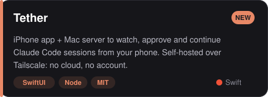
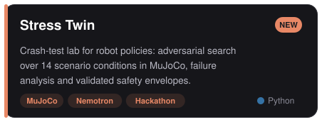
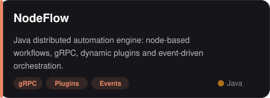
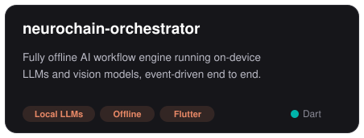
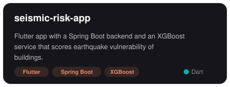
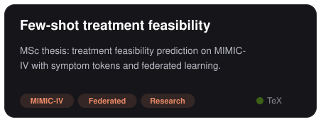
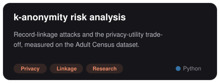

<picture>
  <source media="(prefers-color-scheme: dark)" srcset="assets/banner-dark.svg">
  
</picture>

 

## 👋 About

I build backend systems, mobile apps and AI tools that run where the data lives: on-device models,
offline workflows and self-hosted servers. Java · Python · Dart/Flutter · Swift · Go (learning in public).

## 🚀 Recent

  
  

## 🧩 Selected work

  
  
  
  
  

## 🛠️ Tech

  

## 📈 Activity

  
  

<picture>
  <source media="(prefers-color-scheme: dark)" srcset="https://raw.githubusercontent.com/MohammadSharafi/MohammadSharafi/output/snake-dark.svg">
  
</picture>

## 🔬 Publishing soon

A controlled experiment I built: a React app with **40 deliberately planted WCAG violations**
across 25 success criteria. Industry-standard automated scanning caught **7 of 40**. Every
miss was relational or temporal, the class of defect a static scan structurally cannot see.
Repo and write-up are being packaged now.

Next on the bench: a from-the-metal-up systems ladder: a WAL-backed KV store whose
acceptance test is `kill -9` mid-write, an epoll server from raw sockets, and a mini-Redis
speaking RESP, in Go.

## ⚙️ How I work

- Every claim gets a number; experiments get a written log with an explicit failure metric
- Zero dependencies unless the dependency earns its ownership cost
- Much of my production work is private (enterprise and healthcare); what's here is what I can show
